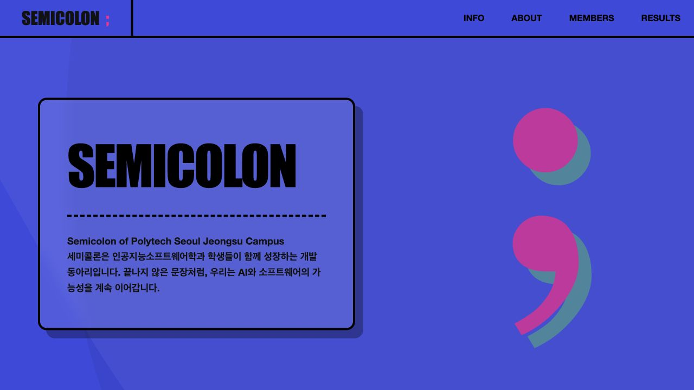
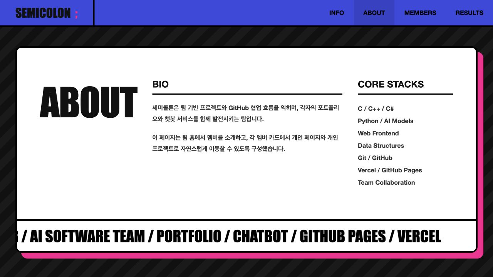
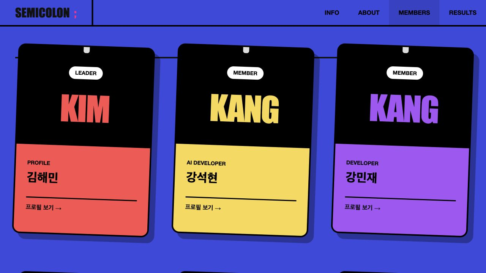
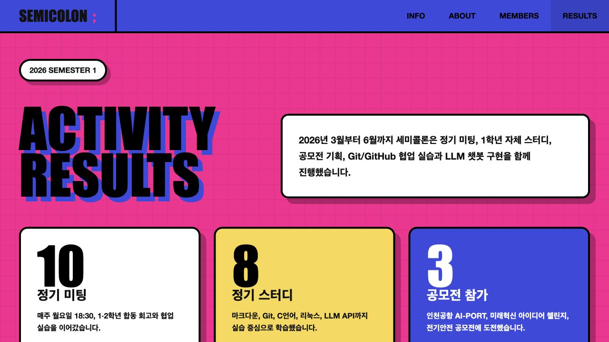

# Semicolon; Team Page

세미콜론 팀 페이지는 Git 협업 실습과 웹페이지 제작을 연습하기 위해 만든 정적 웹사이트입니다.

팀원들이 각자 브랜치에서 개인 프로필 페이지를 만들고, 메인 페이지에 멤버 소개와 2026년 1학기 활동 성과를 연결하면서 Git/GitHub 협업 흐름을 익히는 것을 목표로 합니다.

## 웹 접속 안내

이 프로젝트는 모바일보다 실제 웹 화면에서 보는 것을 권장합니다. 메인 화면에서는 동아리 소개, 팀원 카드, 1학기 활동 성과를 볼 수 있고, 각 팀원 카드에서 개인 프로필 페이지로 이동할 수 있습니다.

| 구분 | 링크 |
| :--- | :--- |
| 라이브 사이트 | [https://semicolon-teampage.vercel.app/](https://semicolon-teampage.vercel.app/) |
| 로컬 메인 페이지 | [index.html](./index.html) |
| 팀원 프로필 페이지 | [pages/](./pages/) |

## 서비스 화면

실제 배포 사이트에서 캡처한 화면입니다. 소개에서 팀원 프로필과 학기 활동 성과로 이어지는 탐색 흐름을 보여줍니다.

| 팀 소개 | 동아리 소개 |
| :---: | :---: |
|  |  |

| 팀원 프로필 탐색 | 1학기 활동 성과 |
| :---: | :---: |
|  |  |


## 이 웹사이트는 무엇인가요?

이 웹사이트는 세미콜론 동아리의 팀 소개 페이지입니다.

- 메인 페이지에서 세미콜론 동아리 소개를 확인할 수 있습니다.
- 멤버 카드에서 각 팀원의 개인 프로필 페이지로 이동할 수 있습니다.
- 2026년 1학기 활동 성과 섹션에서 정기 미팅, 정기 스터디, 공모전 참가, Git 협업, LLM 챗봇 구현 등 주요 활동을 확인할 수 있습니다.
- 일부 개인 페이지에서는 팀원이 진행한 작업물과 외부 링크를 확인할 수 있습니다.
- 모바일 화면에서도 볼 수 있도록 반응형 스타일을 적용했습니다.

## 페이지 구성

| 페이지 | 설명 |
| :--- | :--- |
| [index.html](./index.html) | 동아리 소개, 멤버 카드, 1학기 활동 성과를 보여주는 메인 페이지 |
| [pages/heamin.html](./pages/heamin.html) | 김해민 프로필 및 작업물 링크 |
| [pages/kangProfile.html](./pages/kangProfile.html) | 강석현 프로필 및 프로젝트 소개 |
| [pages/minjae.html](./pages/minjae.html) | 강민재 프로필 및 기술 스택 소개 |
| [pages/suyong.html](./pages/suyong.html) | 박수용 프로필, 프로젝트, 스택 소개 |
| [pages/dhj.html](./pages/dhj.html) | 도형준 프로필, 기술 인벤토리, 프로젝트 소개 |
| [pages/gaeun.html](./pages/gaeun.html) | 이가영 프로필, 기술 스택, 연락처 소개 |

## 메인 페이지 주요 내용

메인 페이지에는 다음 내용이 포함되어 있습니다.

- 세미콜론 동아리 소개
- 팀원 6명의 프로필 카드
- 2026년 1학기 활동 성과
  - 정기 미팅 10회
  - 정기 스터디 8회
  - 공모전 참가 3건
  - Git 협업 체계 정착
  - 팀 웹페이지 제작·배포
  - LLM 챗봇 구현
  - 2학기 확장 계획

## 디렉토리 구조

```text
SEMICOLON-TEAMPAGE
├─ css/              # 스타일시트 파일
│  ├─ index.css      # 메인 페이지 스타일
│  └─ [name].css     # 팀원 개별 프로필 전용 스타일
├─ img/              # 이미지 에셋
├─ pages/            # 팀원 개별 프로필 HTML 페이지
│  └─ [name].html    # 팀원 개별 프로필 파일
├─ index.html        # 팀 소개 메인 페이지
└─ README.md         # 프로젝트 소개 및 협업 컨벤션
```

## 협업 컨벤션

### 파일 관리

- HTML은 페이지 역할에 맞게 [index.html](./index.html) 또는 [pages/](./pages/) 폴더에 작성합니다.
- CSS는 [css/](./css/) 폴더의 외부 스타일시트로 분리합니다.
- 이미지가 필요한 경우 [img/](./img/) 폴더에 저장하고 상대 경로로 연결합니다.

### Git 작업 방식

| 브랜치명 | 용도 |
| :--- | :--- |
| `main` | 최종 배포 및 병합용 |
| `feature/이름` | 기능 추가 및 개인 작업 |

커밋 메시지는 `타입: 제목` 형식으로 작성합니다.

| 타입 | 설명 |
| :--- | :--- |
| `feat` | 새로운 기능 추가 |
| `fix` | 버그 수정 |
| `design` | 디자인 변경 |
| `docs` | 문서 수정 |
| `refactor` | 코드 리팩토링 |
| `chore` | 단순 작업 |
